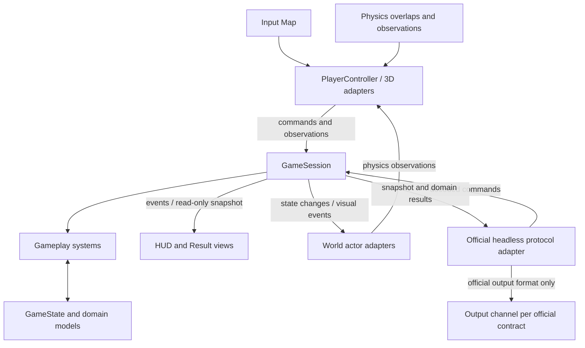

# Kiến trúc game Đảo Đèn Lồng — Phase 1

> Tài liệu thiết kế, chưa phải mô tả triển khai. Không tạo hoặc thay đổi quy tắc gameplay. Các giá trị đề xuất vẫn phải theo PRD và Test Contract chính thức khi có.

## 1. Mục tiêu và nguồn yêu cầu

Kiến trúc hướng tới Godot 4 + GDScript cho game 3D single-player, màn Đêm 1 – Đảo Bến. Mục tiêu chính là logic gameplay có thể kiểm thử không cần render, HUD hay âm thanh.

Thứ tự ưu tiên khi có khác biệt:

1. Test Contract v1.0 chính thức, sau khi được cung cấp.
2. PRD Phase 1.
3. `game.contract.json` hiện tại — bản nháp suy ra từ PRD, không phải Test Contract chính thức.
4. Quyết định kỹ thuật trong tài liệu này.

PRD nói rõ chưa chốt schema JSON, giao thức headless, mã thoát và một số luật có thể do Test Contract quy định. Contract hiện tại tự đánh dấu `draft_prd_derived`, schema/lệnh headless chưa có, và gameplay values là đề xuất. Tài liệu này không định nghĩa schema, lệnh, output hay luật thay thế.

## 2. Phạm vi chức năng và quy tắc

| Phân hệ | Phạm vi Phase 1 |
|---|---|
| Màn chơi | Đảo 3D có mặt đất va chạm, đúng 5 đèn lớn, đom đóm, Bóng Mực và đủ sáng để quan sát; các vị trí bắt buộc tiếp cận được. |
| Nhân vật/camera | Mây đi bốn hướng, nhảy khi đã chạm đất, chịu trọng lực; camera góc nhìn thứ ba bám theo. Phím trong PRD là đề xuất. |
| Đom đóm/ánh sáng | Đom đóm nhìn thấy được, thu thập khi tiếp xúc, không thu thập lặp trước khi tái xuất hiện; ánh sáng có giới hạn và cập nhật nhất quán. |
| Đèn lớn | Tương tác khi ở gần; đèn chưa sáng chỉ được thắp khi đủ ánh sáng; mỗi đèn chỉ tiêu hao một lần. Đèn đã sáng tạo vùng an toàn cho địch. |
| Bóng Mực | Wander, Chase, Repelled, AvoidLight; phát hiện/đuổi theo, gây sát thương hợp lệ nhưng không liên tục mỗi frame, phản ứng với kỹ năng và vùng sáng. |
| Kỹ năng tỏa sáng | Chỉ dùng khi đang chơi, đủ ánh sáng và hết hồi chiêu; tiêu hao một lần, đẩy lùi địch trong phạm vi. |
| Máu/điểm/kết thúc | Máu không dưới 0; không xử lý sát thương sau kết thúc. Điểm không cộng trùng; thưởng máu còn lại chỉ cộng một lần khi thắng. Năm đèn sáng khi người chơi còn sống thì thắng; máu về 0 trước đó thì thua. |
| HUD/replay | HUD thể hiện máu, ánh sáng, tiến độ đèn, điểm, gợi ý tương tác và trạng thái kỹ năng. Replay khởi tạo lại trạng thái ván và đưa về Playing. |
| Headless/bàn giao | Logic chạy lặp lại không cần render; tuân thủ giao thức chính thức khi có. Bằng chứng, tài liệu và tag thuộc quy trình bàn giao, không phải module runtime. |

Contract nháp ghi các giá trị đề xuất: máu 3; ánh sáng 0..10; +1 ánh sáng/đom đóm; -3/đèn; -2/kỹ năng; sát thương 1; miễn nhiễm 1 giây; kỹ năng tác dụng 2 giây/hồi 3 giây; điểm +10/đom đóm, +100/đèn và +50/máu còn lại khi thắng. Các con số này không phải luật chính thức nếu Test Contract quy định khác.

## 3. Điểm chưa rõ và rủi ro

### Test Contract chính thức

- Không thấy Test Contract v1.0 chính thức trong tài liệu được cung cấp. Không thể kết luận dự án đã tuân thủ contract chấm tự động.
- Chưa có schema chính xác, tên trường, kiểu dữ liệu, lệnh chạy, định dạng output, mã thoát, quy tắc lỗi hay danh sách action headless. Không xây adapter theo phỏng đoán.
- Chưa có quy tắc xử lý khi thắng và thua xảy ra gần như đồng thời. PRD yêu cầu quyết định xác định nhưng giao quyền chốt theo Test Contract.
- TC-01..TC-18 trong contract nháp là tiêu chí PRD-derived, không nên nhầm với test chính thức hay schema grader.

### PRD và contract nháp

- Các thông số gameplay được PRD gọi là giả định/đề xuất; contract nháp cũng đánh dấu proposed. Contract chính thức có thể thay đổi giá trị, điểm, cooldown hoặc thời lượng hiệu ứng.
- Chưa định lượng khoảng cách “đến gần” đèn, phạm vi phát hiện, phạm vi kỹ năng, vùng ảnh hưởng đèn.
- Thời điểm/vị trí/chu kỳ tái xuất hiện đom đóm chưa được định lượng; yêu cầu chỉ nói phải có đủ tài nguyên để hoàn thành.
- AI chưa quy định thuật toán, tốc độ, ưu tiên khi nhiều điều kiện cùng đúng hoặc xử lý kẻ địch bị đẩy vào vật cản.
- Chưa quy định số Bóng Mực, bố trí cụ thể, seed ngẫu nhiên, tốc độ di chuyển, thông số nhảy và va chạm.
- Khi nhặt đom đóm lúc ánh sáng tối đa, PRD nói ánh sáng không vượt giới hạn nhưng chưa rõ vật phẩm có bị thu thập và điểm có được cộng không. Chờ contract/quyết định sản phẩm.
- Trạng thái đèn chỉ cần tồn tại trong ván chơi; PRD không yêu cầu lưu qua phiên. Không thêm save system.
- Danh sách delivery của contract nháp ngắn hơn PRD; checklist bàn giao vẫn phải theo PRD đầy đủ.

### Bối cảnh repository

Tài liệu setup hiện có mô tả repository ở CP0/khung môi trường web, chưa phải Godot game. Đây là lệch pha giữa workspace hiện tại và đích kiến trúc. Tài liệu này chỉ thiết kế đích Godot, không di trú project hay tạo scenes/scripts.

## 4. Kiến trúc và module

### Nguyên tắc

1. `GameSession` là chủ sở hữu duy nhất của state ván và điều phối luật.
2. Domain không truy cập `Node3D`, `Control`, `Input`, rendering, âm thanh hoặc scene tree.
3. Adapter chuyển đổi input/va chạm/dữ liệu giao thức; không quyết định luật.
4. Health, light, score, trạng thái đèn và trạng thái game chỉ có một nguồn sự thật.
5. Timer luật dùng simulation time được truyền vào; không dùng đồng hồ hệ thống cho kết quả gameplay.
6. Root scene sở hữu session/dependencies; không cần autoload cho từng hệ thống, service locator hay tầng kiến trúc dư thừa.

| Module | Trách nhiệm | Không chịu trách nhiệm |
|---|---|---|
| `GameSession` | Điều phối command theo thứ tự, gọi luật, cập nhật `GameState`, trả event/snapshot. | Input trực tiếp, render, giao thức ngoài. |
| `GameState` và domain models | State runtime có kiểu: status, health, light, score, đèn, đom đóm và dữ liệu logic cần thiết của địch. | Node/scene, presentation hay lưu file. |
| Gameplay systems | Luật thu thập/tài nguyên/đèn/sát thương/miễn nhiễm/kỹ năng/điểm/thắng-thua/replay. | UI, truy vấn scene tree. |
| `PlayerController` | Đọc Input Map; điều khiển `CharacterBody3D`, trọng lực/va chạm và camera; phát intent gameplay. | Tự đổi health, light, score hoặc game status. |
| World actor adapters | Đặt collision/Area3D; chuyển overlap/observation thành command; phản ánh state bằng hình ảnh actor. | Nguồn state thứ hai hoặc tự trao thưởng. |
| Enemy adapter/brain | Điều khiển chuyển động vật lý và thu thập observation; nếu cần headless, quyết định luật AI thuộc core và adapter chỉ thi hành intent. | Tự gây sát thương/xua đuổi ngoài luật session. |
| `HudView` / `ResultView` | Hiển thị snapshot/event, gợi ý tương tác và gửi yêu cầu Replay. | Sửa state hoặc tính điểm. |
| `HeadlessRunner` | Đọc/ghi đúng Test Contract chính thức và gọi cùng gameplay core. | Định nghĩa schema/luật riêng. |
| `LevelDefinition` | Dữ liệu tĩnh: vị trí spawn/đèn/đom đóm/vùng sáng và cấu hình world. | State động của ván. |

`GameSession` và model có thể dùng GDScript `RefCounted`, không cần dựng scene để chạy luật. Chỉ tách system khi có ranh giới kiểm thử thật sự.

### Luồng dữ liệu



Ví dụ tương tác đèn: `E` → controller/world adapter xác định đèn mục tiêu → gửi `interact(lantern_id)` → session kiểm tra trạng thái/ánh sáng/đèn → cập nhật state và phát kết quả → actor/HUD phản ánh state. Scene không tự trừ light hoặc cộng score.

## 5. Tách Game Logic khỏi 3D và HUD

Ranh giới sau là giao diện **nội bộ**, không phải schema JSON/headless:

- Adapter gửi command/intent có ý nghĩa gameplay (thu thập ID, tương tác ID đèn, dùng kỹ năng, báo sát thương hợp lệ) và observation tối thiểu cần cho luật.
- Session kiểm tra game đang `Playing`, tính hợp lệ, cập nhật state một lần và phát event/kết quả.
- Adapter đọc snapshot hoặc signal `state_changed` / `game_ended` để cập nhật scene/UI.
- Thao tác không hợp lệ trả kết quả rõ ràng, không sửa dở dang state. Tên action/lỗi ngoài vẫn chờ Test Contract.
- Không đưa camera transform, VFX hoặc node reference vào phép tính điểm/tài nguyên. Nếu luật cần điều kiện không gian, adapter gửi observation rõ ràng.

Movement và va chạm thân thể thuộc `CharacterBody3D` vì dùng physics Godot. Quy tắc kết quả gameplay (nhảy hợp lệ, damage cooldown, tiêu hao, điểm, kết thúc) phải có kiểm thử độc lập; adapter không ghi trực tiếp các giá trị đó.

Để giữ tính xác định:

- Session tuần tự hóa state mutation theo thứ tự nhận command.
- Callback overlap lặp không được trao thưởng lặp.
- Kết quả không phụ thuộc FPS, render, âm thanh hay VFX.
- Cooldown, miễn nhiễm và hiệu lực kỹ năng dùng simulation time truyền vào.
- Xung đột thứ tự sự kiện, nhất là đồng thời thắng/thua, chờ quy tắc chính thức; không tự chốt ở adapter.

## 6. Scene tree và cấu trúc thư mục dự kiến

```text
res://
  project.godot
  scenes/
    main/
      main.tscn
      main.gd
    world/
      island.tscn
      island.gd
    actors/
      player/
        player.tscn
        player_controller.gd
      enemies/
        ink_shadow.tscn
        ink_shadow_adapter.gd
      collectibles/
        firefly.tscn
        firefly_adapter.gd
      interactables/
        large_lantern.tscn
        lantern_adapter.gd
    ui/
      hud.tscn
      hud_view.gd
      result_view.tscn
      result_view.gd
  src/
    core/
      game_session.gd
      game_state.gd
      game_command.gd
      game_event.gd
      models/
      systems/
    adapters/
      headless/
        headless_runner.gd
        contract_codec.gd
    data/
      island_level_definition.gd
  tests/
    core/
    headless/
  docs/
    ARCHITECTURE.md
```

`contract_codec.gd` là nơi duy nhất ánh xạ giao thức ngoài sang command và từ state/result sang output. Chỉ hoàn thiện sau khi nhận schema chính thức.

```text
Main (Node)
├── GameSessionOwner (Node)  # composition/ownership, không chứa luật
├── Island (Node3D)
│   ├── Environment
│   ├── Player (CharacterBody3D)
│   │   └── CameraRig
│   ├── Lanterns
│   ├── Fireflies
│   └── Enemies
└── UI (CanvasLayer)
    ├── HUD
    └── ResultView
```

Root tạo một session và truyền cùng instance cho scene/world/UI. Level config khởi tạo đúng 5 đèn theo PRD. Actor/UI không được tự tạo session.

## 7. Headless và kiểm thử tự động

### Thiết kế

1. `HeadlessRunner` là entry adapter riêng, khởi tạo `GameSession` và cấu hình level; không khởi tạo renderer, camera, HUD hay âm thanh.
2. Dùng cùng domain systems của game tương tác; không tạo bản gameplay thứ hai chỉ dành cho test.
3. Chuyển input/output đúng Test Contract v1.0 sau khi được cung cấp. Hiện chưa chốt command, schema, stdin/file, stdout, mã thoát hay định dạng lỗi.
4. Tiêm simulation time và nguồn ngẫu nhiên khi cần; không dựa vào frame rate hoặc thời gian thực.
5. Tách unit test domain khỏi contract test adapter. Contract test kiểm tra đúng định dạng chính thức khi có.
6. Xác minh tính lặp lại theo seed/input mà contract chính thức yêu cầu; không tự thêm trường seed/action.

| Loại kiểm thử | Nội dung |
|---|---|
| Unit — core | Khởi tạo; giới hạn light/health; thu thập/chống trùng; thắp đủ/thiếu light; tiêu hao một lần; sát thương/miễn nhiễm; skill cost/cooldown; điểm/bonus; win/loss; replay. |
| Integration — headless | Sau khi có contract: lệnh, parse/validation, output, lỗi, mã thoát, scenario và tính xác định chính thức. |
| Scene/physics | Ground collision, jump/land, vùng tương tác, vị trí đèn/firefly, camera và chuyển động/avoid-light. Tách khỏi contract logic không cần render. |
| Acceptance | TC-01..TC-18 của PRD là checklist tham khảo; TC-18 và giao thức phải theo tiêu chí chính thức khi nhận được. |

Khi nhận Test Contract: đối chiếu luật/giá trị/scenario; ghi nhận override; chỉ cập nhật boundary `HeadlessRunner`/`ContractCodec` cho format ngoài; chạy lại core regression. Không sửa PRD/contract trong quá trình này nếu chưa được yêu cầu.

## 8. Ma trận phụ thuộc

Mũi tên `A → B` nghĩa là A gọi/đọc B.

```text
Main/CompositionRoot → GameSession, LevelDefinition, Scenes, Views
GameSession → GameState, GameplaySystems, GameCommand/Event
GameplaySystems → GameState, domain models
PlayerController → GameSession interface, Godot Input/Physics/Camera
World actor adapters → GameSession interface, Godot Nodes/Physics
HUD/Result views → GameSession read-only interface, Godot UI
HeadlessRunner → GameSession, ContractCodec, LevelDefinition
ContractCodec → kiểu command/result nội bộ; không sở hữu gameplay rules
```

- `src/core` không import scenes, UI, actor adapters, file protocol hoặc singleton scene-tree.
- Scene/adapter được phép phụ thuộc core; core không phụ thuộc ngược.
- HUD chỉ đọc snapshot/event, không phụ thuộc actor hay system cụ thể.
- Mọi thay đổi gameplay đi qua session.
- Headless và giao diện tương tác là hai adapter ngang hàng, cùng dùng core.

## 9. Trình tự triển khai sau khi duyệt

1. Nhận/đối chiếu Test Contract chính thức; chốt các điểm pending.
2. Tạo project Godot, model/session tối thiểu và unit tests không cần scene.
3. Nối level, player controller, camera; xác nhận va chạm và khả năng tiếp cận.
4. Nối firefly/light, lantern, enemy/health và glow qua cùng session.
5. Nối HUD, điểm, kết thúc và replay bằng snapshot/event.
6. Tạo headless adapter theo schema/lệnh chính thức; chạy test và xác minh tính xác định.
7. Thêm hiệu ứng P1 như consumer của event/state; xác nhận không đổi kết quả contract.
8. Kiểm thử nền tảng, lưu bằng chứng và bàn giao theo PRD.

Đây là kế hoạch kiến trúc, không phải xác nhận các bước đã được triển khai.